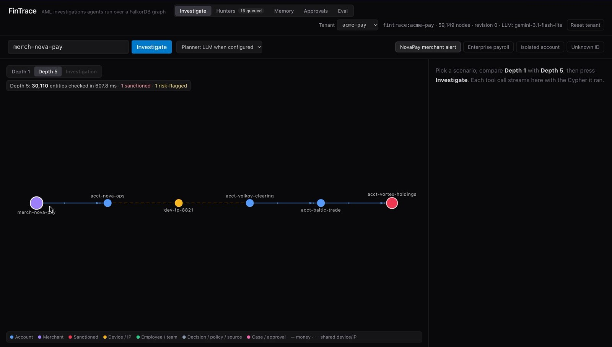
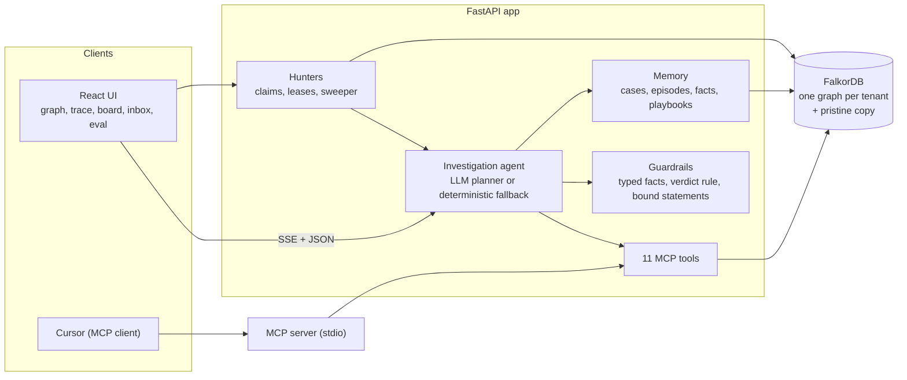
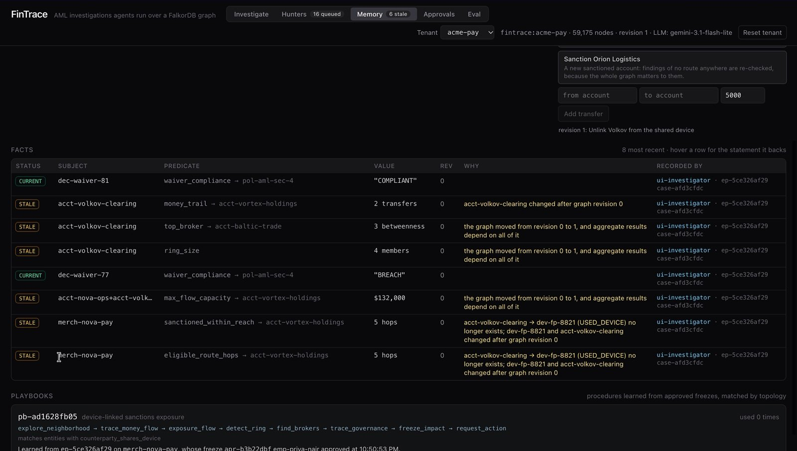
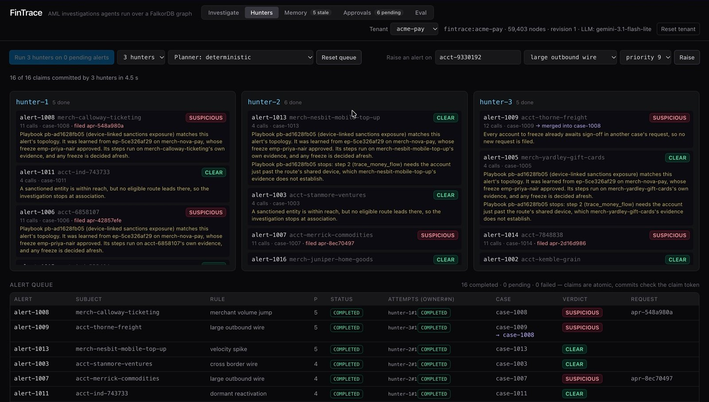
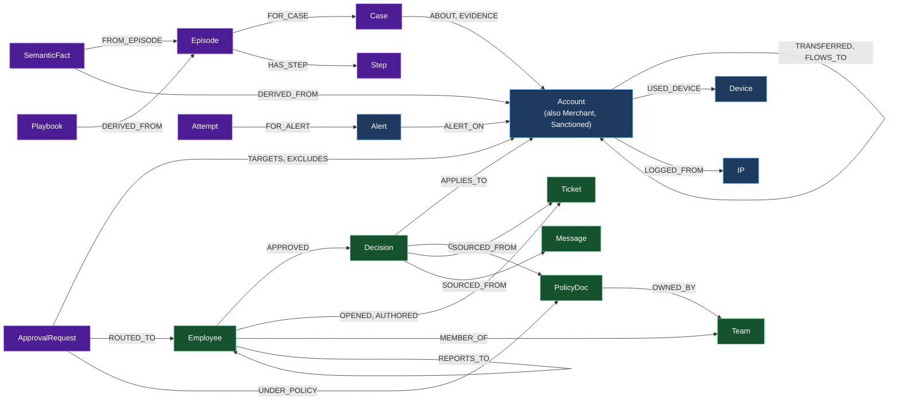

# FinTrace

AML investigation agents whose context lives in a FalkorDB graph: the money, the devices and IPs behind it, the
company's own people and policies, and everything the agents have learned.

An alert lands on a merchant. One hop out, nothing looks wrong. Five hops out, through a device the merchant's
payout account shares with a clearing account, the money reaches a sanctioned holding company. FinTrace's agents
find that route, show what it rests on, check who in the company waived the control that should have
caught it, ask the right on-call officer to approve a surgical freeze, and remember all of it, so the next
investigation starts from what is already known and notices when the evidence changes.

The work falls into three parts: [acting on connected data](#acting-on-connected-data),
[memory and coordination](#memory-and-coordination) and [company knowledge](#company-knowledge).

- **Demo video:** [Watch on YouTube](https://www.youtube.com/watch?v=zV04hk4sivE)
- **Blog post:** [How FinTrace detects stale agent memory with FalkorDB](https://medium.com/@gunasaimahesh/how-fintrace-detects-stale-agent-memory-with-falkordb-c1125c90627c)
- **Live demo:** [app-production-1451.up.railway.app](https://app-production-1451.up.railway.app) (shared demo graph; see [Public demo](#public-demo))
- **Repository:** https://github.com/gunasaimahesh/fintrace



*Depth 5 in the live demo: 30,110 entities checked, and the route from NovaPay (purple) to a sanctioned account
(red) through a device that NovaPay's payout account shares with a clearing account.*

Everything here is demo data: the transfers are **IBM synthetic AML data**, and the people, policies, tickets and
sanctions entries are synthetic. Approver sign-off in the UI is simulated, not authenticated.

## Results at a glance

Details, failures and caveats are in [Evaluation](#evaluation).

- **Detection.** On 16 alerts designed for this evaluation (seven with a route to a sanctioned account, nine
  look-alikes), the agent's verdict and route were right on every run: 48 of 48 with the LLM planner and 48 of 48
  with the deterministic planner, over three repeats. One-entity lookups with the same 14-call budget couldn't
  decide 12 of the 48 with either planner, and never gave a wrong verdict.
- **Memory.** Asked about the same alert again, the agent answers from memory in a median of 2 tool calls. When
  the evidence under a remembered route changes, the route is marked stale and the next run investigates again.
- **Learning.** A playbook learned from the approved NovaPay investigation applied to four held-out alerts and
  cut LLM requests and tokens on all 12 of their runs, for one or two extra tool calls (one case went from 9
  requests and 59,043 tokens to 2 and 18,662).
- **Coordination.** In a queue benchmark with 20 claimants and injected crashes, stalls and failures (5 runs of
  200 alerts), no alert was lost or completed twice and all 69 late commits were refused; 993 alerts completed
  and 7 ended FAILED after three attempts.
- **One result went against us.** Gathering the members of 370 laundering instances in the IBM synthetic AML
  data, our graph tools reached a macro recall of 0.615 against 0.679 for plain lookups, with three calls each.
  That benchmark measures evidence retrieval from a known member, not alert detection.

## Verify our claims in two minutes

```bash
git clone https://github.com/gunasaimahesh/fintrace && cd fintrace
docker compose up --build -d          # FalkorDB + the app; the first start seeds both tenants (seconds)
open http://localhost:8000            # or visit it in a browser
```

1. **Investigate** tab: press *Depth 1*, then *Depth 5* (31 entities and nothing sanctioned, then 30,110 entities
   and one sanctioned account five hops away). Press *Investigate* and watch each tool call stream in with the
   Cypher it ran. Without an LLM key the deterministic planner runs; add one in `.env` for the model planner.
2. **Approvals** tab: sign off the freeze request as the simulated on-call L3 officer.
3. **Memory** tab: add a transfer, unlink an account from the shared device or sanction an account, and see which
   remembered facts go stale and why.
4. **Hunters** tab: three hunters drain the 16-alert queue through claims and leases.
5. **Eval** tab: every measured result below, read from `backend/eval/results.json`.

```bash
docker compose exec app python -m pytest backend/tests -q     # 137 tests, about a minute
```

## How it works



- **The agent** (`backend/app/agent.py`) always resolves the alert entity and checks memory first, so an unknown
  ID never reaches the model. An LLM (any OpenAI-compatible endpoint; we used `gemini-3.1-flash-lite`) then picks
  tools turn by turn, at most 14 calls per alert. Without a key, or if the model fails mid-run, a deterministic
  planner continues from the results so far.
- **The verdict comes from the evidence, not the model** (`guardrails.py`). Every statement on the analyst's card
  is rendered from a typed fact bound to the tool result it came from (tool, step, result key). The model may
  propose statements; they are bound to facts or rejected with a reason, and its rationale is shown as unverified.
- **The same 11 tools** serve the agent in-process and Cursor over MCP (`mcp_server.py`; `.cursor/mcp.json` is
  included). Each returns the data the model reads, the evidence (every entity and edge shown), and the
  parameterized Cypher that ran, for the trace inspector.

| Tool | What it answers |
|---|---|
| `resolve_entity` | Look up an entity by ID |
| `recall_memory` | Remembered facts (CURRENT, or STALE with the reason), recent episodes, approval requests and playbooks |
| `explore_neighborhood` | Counts per depth of everything connected, flagged or sanctioned entities with a path to each, and the eligible routes |
| `trace_money_flow` | Time-ordered money flow downstream or upstream over individual transfers |
| `path_between` | Shortest connection between two entities across money and shared devices/IPs |
| `detect_ring` | Label-propagation community containing a risk-layer entity |
| `find_brokers` | Members of a ring ranked by betweenness (who the money has to pass through) |
| `exposure_flow` | Maximum dollars that could move from source accounts to a target (multi-source max flow) |
| `trace_governance` | Decisions applying to an entity, their approvers, sources and policy, and the on-call approvers for a freeze |
| `freeze_impact` | Legitimate customers who share a device or IP with accounts you plan to freeze |
| `request_action` | Ask the on-call approver to sign off a freeze; nothing is frozen until they approve |

**Why one graph.** An investigation here walks across different kinds of relationships: transfers between
accounts, a device two accounts both log in from, the decision that waived a control for the merchant and the
employee who approved it, and the facts and freeze requests that earlier investigations wrote. In FalkorDB they
are all edges of one graph. The route search can follow money into an identity link and back into money; a
remembered fact points at the edges it rests on, which is how it notices when they change; and a freeze
request points at the accounts it targets and the evidence it was filed on. NovaPay's depth-5 neighbourhood
(30,110 entities) is searched in about 0.3 s in a saved local measurement (`backend/tests/checkpoint_report.json`).

## Acting on connected data

- **Depth changes the answer.** One hop out, NovaPay's neighbourhood is 31 entities and nothing sanctioned. Five
  hops out, it is 30,110 entities and a route to a sanctioned account. Try the *Depth 1 / Depth 5* toggle.
- **Routes follow the money.** Transfers count only in the direction the money moved. A device shared by two
  accounts links them and counts as two hops (account → device ← account). A shared IP, or money flowing back, is
  association, not exposure. A route that obeys these rules is an *eligible route*.
- **CLEAR has to be earned.** One verified eligible route to a sanctioned account makes a subject SUSPICIOUS, even
  if other searches were incomplete. CLEAR needs a complete search that finds none: to the prescribed depth of six
  hops, or until nothing new is reachable. A search that hits its cap or times out without finding a route is
  INSUFFICIENT, not CLEAR. A sanctioned account more than six hops away gets a qualified CLEAR.
- **Reported statements must be supported by tool evidence.** Each statement on the analyst's card is bound to a
  typed fact from a tool result. The model may propose statements; they are bound to facts or rejected with a
  reason, so swapping in another number, another subject's path length or another approval's status is caught.
  The model's free-form rationale is shown, marked unverified.
- **Only the alert's own entity decides its verdict.** A route or a complete search the model ran from another
  account is reported as context. A sanctioned subject is SUSPICIOUS as direct exposure, never CLEAR, and is never
  put up for a freeze, since it is already blocked.
- **An unknown ID stops after one call** instead of guessing.
- **Cursor gets the same 11 tools over MCP** as the agent.
- **Nothing gives the answer away:** not the graph, the tool schemas or the prompt.

How this holds up on labelled cases: [Results at a glance](#results-at-a-glance) and [Evaluation](#evaluation).

<details>
<summary>Tests behind these claims</summary>

- Depth, in [`test_graph_checkpoints.py`](backend/tests/test_graph_checkpoints.py):
  `test_depth_one_is_clean_and_depth_five_reaches_one_sanctioned`, `test_novapay_is_exactly_five_hops_from_vortex`
- Routes: `test_eligible_routes_keep_direction_and_a_device_bridge_costs_two_hops`
  ([`test_tools.py`](backend/tests/test_tools.py)), `test_a_valid_route_is_found_despite_a_shorter_ip_path`
  ([`test_agent.py`](backend/tests/test_agent.py)), `test_a_shared_ip_or_money_flowing_back_is_only_association`
  ([`test_guardrails.py`](backend/tests/test_guardrails.py))
- Verdicts: `test_clear_needs_the_prescribed_depth_or_an_exhausted_frontier`
  ([`test_guardrails.py`](backend/tests/test_guardrails.py)), `test_a_capped_or_timed_out_search_is_insufficient_not_clear`
  and `test_a_sanctioned_account_beyond_six_hops_gets_a_qualified_clear` ([`test_agent.py`](backend/tests/test_agent.py))
- Bound statements: `test_model_statements_are_bound_to_facts_or_rejected` ([`test_agent.py`](backend/tests/test_agent.py)),
  `test_swapping_monthly_volume_for_exposure_is_rejected`, `test_another_subjects_path_length_is_rejected` and
  `test_another_approvals_status_is_rejected` ([`test_guardrails.py`](backend/tests/test_guardrails.py))
- The subject's own facts: `test_a_route_the_model_found_from_another_account_does_not_decide_the_subject`,
  `test_a_complete_search_the_model_ran_from_another_account_does_not_clear_the_subject` and
  `test_a_sanctioned_subject_is_suspicious_without_a_route_and_is_not_put_up_for_freezing`
  ([`test_agent.py`](backend/tests/test_agent.py)), `test_a_sanctioned_account_is_never_put_up_for_a_freeze`
  ([`test_tools.py`](backend/tests/test_tools.py))
- Unknown ID: `test_an_unknown_id_stops_after_one_call` ([`test_agent.py`](backend/tests/test_agent.py))
- MCP: `test_the_stdio_server_lists_the_eleven_tools_and_answers` ([`test_mcp_stdio.py`](backend/tests/test_mcp_stdio.py))
- No answer leaks: `test_no_ground_truth_in_graph` ([`test_graph_checkpoints.py`](backend/tests/test_graph_checkpoints.py)),
  `test_tool_schemas_and_the_prompt_name_nothing_from_the_scenario` ([`test_leaks.py`](backend/tests/test_leaks.py))

</details>

## Memory and coordination

What the agents learn is stored in the graph next to the evidence it rests on, so they notice when that evidence
changes. The demo walks through it:

1. **Investigate.** The NovaPay investigation finds the five-hop route and files a freeze request.
2. **Remember.** The run is saved as a `:Case`, an `:Episode` with its `:Step`s, and typed `:SemanticFact`s, each
   linked (`DERIVED_FROM`) to the entities and edges it rests on.
3. **Answer from memory.** A new session asked about the same alert answers from those facts (a median of 2 tool
   calls in the evaluation).
4. **Change the evidence.** In the Memory tab, *Unlink Volkov from the shared device* removes one link of the route
   and moves the graph to its next revision.
5. **Detect stale memory.** The facts that rested on that link, and the aggregates, turn STALE, each with its
   reason. Facts that don't depend on it stay CURRENT.
6. **Investigate again.** The next investigation of NovaPay doesn't reuse the stale route: it searches again, and
   its new fact SUPERSEDES the stale one.



*Step 5 in the live demo. After unlinking Volkov from the shared device (revision 1), the facts that rested on
Volkov or on that link, and the aggregates (max flow, ring, brokers), are STALE, each with its reason. The two
waiver-compliance facts stay CURRENT.*

**How a fact knows it is stale.** Every write that changes evidence increases the graph *revision* and stamps what
it touched. On recall, a route goes STALE only when something it depends on changed. A CLEAR finding or an
aggregate (max flow, ring, brokers) goes STALE on any change, since it depends on the whole neighbourhood. Facts
are written CURRENT only if the graph is still at the revision the investigation started from, so a change during
an investigation is never cached as current.

**Nothing is frozen on stale evidence.**

- A freeze request is created in one write, with its target and exclusion links and the evidence it rests on: what
  the verdict's facts depend on, unchanged since the investigation started. It can't be signed off half-built or
  with only its targets checked, and a request missing a target link freezes nothing.
- Sign-off is refused if the evidence under the request changed. It commits in one write that requires the graph to
  still be at the revision whose evidence it checked, so neither a change during the check nor a second approver
  racing it can freeze on stale evidence or freeze twice.

**Playbooks: procedural memory.** An approved investigation can produce a `:Playbook` when its tool arguments can
be generalized into roles: each ID is replaced by the role it played (the subject, the sanctioned end of the route,
the accounts around the shared device), and if any ID played no role, nothing is learned. A playbook matches new
alerts by topology alone, binds its roles from the new subject's live results step by step, and stops where that
subject's evidence does. It never replays an approval: the planner decides any freeze afresh. Learned from the
NovaPay investigation, it applied to four held-out cases and, with the LLM planner, cut requests and tokens on all
12 of their runs without changing a verdict, for one or two extra tool calls ([Evaluation](#evaluation)).

**Hunters coordinate only through graph state.** Alerts go PENDING → CLAIMED → COMPLETED or FAILED.

- A claim is one write that stamps a fresh *claim token*, a *lease* and an `:Attempt`. Renewing, completing or
  failing commits only if the alert still carries that token and the lease hasn't run out.
- The hunter's case, facts, case merges and freeze request are written under the same check, in the same query. A
  hunter whose claim passed to another publishes nothing but its own episode (kept as a record, marked
  `claim_lost`) and stops once it notices.
- A sweeper returns expired claims; an alert gets up to three attempts.
- Hunters build on each other's work: a later hunter reuses an earlier hunter's route and defers to its pending
  freeze instead of filing another, and cases merge when they share a high-risk entity (a sanctioned account or a
  flagged device) or at least two entities.

A separate queue benchmark, 20 claimants with injected crashes, stalls and failures, lost no alert and completed
none twice ([Contention](#contention)).



*The Hunters tab in the live demo: three hunters drained the 16-alert queue. The NovaPay playbook ran where an
alert's topology matched and stopped where that alert's evidence did; alert-1009's hunter found every account
already awaiting sign-off in another case's request, filed nothing new, and its case merged into case-1008.*

**Tenants.** Each tenant has its own graph and pristine copy; memory, episodes, queue, approvals, revision and
reset stay inside it through the API. This is demo data isolation, not access control.

<details>
<summary>Tests behind this section</summary>

- Memory, in [`test_memory.py`](backend/tests/test_memory.py): `test_a_new_session_answers_from_memory`
- Staleness, in [`test_memory.py`](backend/tests/test_memory.py):
  `test_an_unrelated_transfer_keeps_the_route_and_refreshes_only_the_aggregates`,
  `test_deleting_a_route_transfer_updates_its_summary_and_stales_the_route`,
  `test_a_clear_finding_goes_stale_on_any_change`, `test_a_change_during_the_investigation_is_not_cached`
- Freeze requests and sign-off, in [`test_memory.py`](backend/tests/test_memory.py):
  `test_a_request_is_complete_from_the_moment_it_can_be_signed_off`,
  `test_a_request_rests_on_its_route_from_the_moment_it_is_filed`,
  `test_a_request_missing_a_target_link_freezes_nothing`, `test_sign_off_is_refused_once_the_evidence_changed`,
  `test_evidence_removed_while_sign_off_checks_it_freezes_nothing`, `test_racing_sign_offs_approve_once`
- Playbooks, in [`test_playbook.py`](backend/tests/test_playbook.py):
  `test_a_playbook_is_learned_from_an_approved_run_and_holds_roles_not_ids`,
  `test_it_matches_held_out_subjects_by_topology_alone`,
  `test_on_a_lookalike_it_stops_where_the_evidence_does_and_the_answer_stays_clear`
- Hunters, in [`test_coordination.py`](backend/tests/test_coordination.py):
  `test_a_lapsed_lease_cannot_renew_complete_or_fail_even_before_the_sweep`,
  `test_a_hunter_whose_claim_passed_on_mid_run_publishes_nothing_and_the_new_owner_finishes`,
  `test_three_hunters_drain_the_queue_without_losing_or_duplicating_work`,
  `test_a_later_hunter_reuses_an_earlier_hunters_route_and_defers_to_its_freeze`,
  `test_cases_merge_only_on_a_high_risk_entity_or_two_shared_entities`
- Tenants, in [`test_tenants.py`](backend/tests/test_tenants.py):
  `test_memory_queue_approvals_revision_and_reset_stay_inside_their_tenant`

</details>

## Company knowledge

The company's own knowledge is part of the graph, built from source files in `backend/data/company/` (synthetic):
the org chart (`org.toml`), policies (`policies/*.md`, TOML front matter), tickets, chat messages and approval
decisions. Every node records its `source_path`, `source_ref` and a `content_hash`, and re-syncing unchanged files
writes nothing.

The NovaPay story runs through it. In September, Rohan Mehta, an L2 onboarding manager, waived device
attestation for NovaPay (`dec-waiver-77`, sourced from a ticket and a Slack message). Policy AML §4.2 requires L3
for waivers on merchants above $250,000 a month, and NovaPay does $410,000. `trace_governance` finds the breach,
and §4.5 says a freeze needs L3 and must exclude infrastructure shared with unrelated customers, so the agent:

- checks collateral with `freeze_impact` (an enterprise payroll account shares a proxy IP with the ring, so the IP
  stays open and the account is spared),
- files the request with `request_action`, routed to the on-call L3 officer, Priya Nair,
- freezes nothing until she signs off in the Approval Inbox, and the sign-off re-checks the evidence.

**Keeping company knowledge current.** Raising the waiver threshold in the policy file and re-syncing clears the
breach in one revision, and the waiver-compliance fact goes stale while the sanctions route stays current. The
approver ID in the UI is chosen in the browser: role switching is simulated, not authenticated.

<details>
<summary>Tests behind this section</summary>

- Provenance, in [`test_company.py`](backend/tests/test_company.py): `test_every_company_node_carries_its_provenance`,
  `test_unchanged_files_cause_no_writes`
- The freeze, in [`test_tools.py`](backend/tests/test_tools.py): `test_a_freeze_needs_an_on_call_l3_and_happens_only_on_sign_off`
- Policy changes: `test_raising_the_waiver_threshold_clears_the_breach_in_one_revision`
  ([`test_company.py`](backend/tests/test_company.py)), `test_a_policy_edit_refreshes_the_waiver_check_and_keeps_the_route`
  ([`test_memory.py`](backend/tests/test_memory.py))

</details>

## Graph data model



Blue: money, identity and alerts. Green: the company layer. Purple: what investigations and hunters write
(simplified; `AUTHORED` goes to `Message`, and facts derive from any evidence, not only accounts).

Every node carries `:Entity` and a unique `id` (indexed). The seeded graph for tenant `acme-pay`
(`python -m backend.app.seed_data`):

| Layer | Nodes | Relationships |
|---|---|---|
| Money (IBM synthetic AML, HI-Small slice) | 40,091 `:Account` (6 also `:Merchant`, 12 also `:Sanctioned`) | 429,039 `TRANSFERRED` (one per transfer: `tx_id`, `amount` in cents, `ts`, `channel`); 57,037 `FLOWS_TO` summaries (one per account pair: `amount`, `transfers`, `first_ts`, `last_ts`, `capacity`) |
| Identity (synthetic) | 10,109 `:Device`, 8,918 `:IP` | 10,120 `USED_DEVICE`, 16,883 `LOGGED_FROM` |
| Company (synthetic, from files) | `:Employee`, `:Team`, `:PolicyDoc`, `:Decision`, `:Ticket`, `:Message` | `MEMBER_OF`, `REPORTS_TO`, `APPROVED`, `APPLIES_TO`, `GOVERNED_BY`, `SOURCED_FROM`, `OPENED`, `AUTHORED`, `OWNED_BY` |
| Work queue | 16 `:Alert` | `ALERT_ON` |
| `:Meta {key: 'dataset'}` | data window, fixture version, and `rev`, the graph revision | |

Accounts, devices and IPs also carry `:RiskNode`, the scope of the graph algorithms. Investigations and hunters
then write their own layer into the same graph:

```text
Investigations
  (:Case)-[:ABOUT]->(subject)                        also from an :Episode or a :SemanticFact
  (:Case)-[:EVIDENCE]->(entity)
  (:Case)-[:MERGED_INTO]->(:Case)
  (:Episode)-[:FOR_CASE]->(:Case)
  (:Episode)-[:HAS_STEP]->(:Step)
  (:SemanticFact)-[:FROM_EPISODE]->(:Episode)
  (:SemanticFact)-[:DERIVED_FROM]->(evidence)
  (:SemanticFact)-[:SUPERSEDES]->(:SemanticFact)
Freeze requests
  (:ApprovalRequest)-[:TARGETS]->(:Account)
  (:ApprovalRequest)-[:EXCLUDES]->(spared entity)
  (:ApprovalRequest)-[:ROUTED_TO]->(:Employee)
  (:ApprovalRequest)-[:UNDER_POLICY]->(:PolicyDoc)
  (:ApprovalRequest)-[:FOR_CASE]->(:Case)
  (:Employee)-[:SIGNED_OFF]->(:ApprovalRequest)      once approved
Learning
  (:Playbook)-[:DERIVED_FROM]->(:Episode)
  (:Episode)-[:USED_PLAYBOOK]->(:Playbook)
Hunters
  (:Attempt)-[:FOR_ALERT]->(:Alert)
  (:Episode)-[:REUSED]->(:SemanticFact)
  (:Episode)-[:DEFERRED_TO]->(:ApprovalRequest)
```

**Money and identity are different things.** A shared device or IP links people, not funds. The verdict rule
follows transfers only in their own direction, crosses identity only through a shared device
(account → device ← account, counted as two hops), and never follows a shared IP. A sanctioned account reachable
only through an IP, or only against the direction of the money, is an association, not exposure.

**Summary edges keep traversal tractable.** The IBM slice has many parallel transfers per account pair, so
traversals run over one `FLOWS_TO` per pair, and `trace_money_flow` drops to the raw `TRANSFERRED` edges when
time order matters. Every transfer write updates both together (`mutations.py`).

## Core Cypher and algorithms

**Breadth-first, one hop per query.** FalkorDB's variable-length patterns enumerate every path (parallel transfers
make depth 4+ time out), `algo.SSpaths` enumerates paths too, and `algo.BFS` only follows outgoing edges, so none
could count a depth-5 undirected neighborhood within a second. Each level is one query over internal IDs; Python
keeps the parents, the node and time budgets, and a record of how much of the requested scope was covered:

```cypher
// eligible route search, from the accounts on the frontier (queries.py)
UNWIND $frontier AS nid
MATCH (a) WHERE ID(a) = nid
MATCH (a)-[:FLOWS_TO|USED_DEVICE]->(b)
WITH b, min(ID(a)) AS parent
RETURN collect(ID(b)), collect(parent),
       collect(CASE WHEN b:Device THEN 1 ELSE 0 END),
       collect(CASE WHEN b:Sanctioned THEN ID(b) END)

// ... and from the devices on the frontier: back to every account that used them
UNWIND $frontier AS nid
MATCH (d) WHERE ID(d) = nid
MATCH (d)<-[:USED_DEVICE]-(b)
WITH b, min(ID(d)) AS parent
RETURN collect(ID(b)), collect(parent),
       collect(CASE WHEN b:Device THEN 1 ELSE 0 END),
       collect(CASE WHEN b:Sanctioned THEN ID(b) END)
```

NovaPay's depth-5 neighborhood (30,110 entities) takes about 0.3 s; the busiest hub's (45,460 entities) about
0.6 s (`backend/tests/checkpoint_report.json`).

**Time-ordered money flow** follows individual transfers, each hop only after the money arrived:

```cypher
UNWIND $frontier AS f
MATCH (a) WHERE ID(a) = f[0]
MATCH (a)-[t:TRANSFERRED]->(b)
WHERE t.ts >= f[1] AND t.ts <= $until AND t.amount >= $min_amount
WITH b, collect([t.ts, ID(a), t.amount, t.tx_id]) AS options
RETURN collect(ID(b)),
       collect(reduce(best = head(options), o IN options | CASE WHEN o[0] < best[0] THEN o ELSE best END))
```

**Graph algorithms:**

```cypher
// detect_ring: the community around an entity
CALL algo.labelPropagation({nodeLabels: ['RiskNode'], relationshipTypes: $rels, maxIterations: 10})
YIELD node, communityId
WITH communityId, collect(node.id) AS members WHERE $id IN members
RETURN size(members), members[0..$limit]

// find_brokers: betweenness inside the ring only, scoped by a temporary label
CALL algo.betweenness({nodeLabels: ['BrokerScope_1'], relationshipTypes: $rels, samplingSize: 64, samplingSeed: 42})
YIELD node, score RETURN node.id, score ORDER BY score DESC

// exposure_flow: how much could reach the target from several sources at once
MATCH (s:Entity) WHERE s.id IN $sources AND s:Account
WITH collect(s) AS sources MATCH (t:Entity {id: $target})
CALL algo.maxFlow({sourceNodes: sources, targetNodes: [t], nodeLabels: ['Account'],
                   relationshipTypes: ['FLOWS_TO'], capacityProperty: 'capacity'})
YIELD edges, edgeFlows, maxFlow
RETURN maxFlow, [e IN edges | [startNode(e).id, endNode(e).id]], edgeFlows

// path_between: shortest connection across money and shared devices/IPs
MATCH (a:Entity {id: $from_id}), (b:Entity {id: $to_id})
CALL algo.SPpaths({sourceNode: a, targetNode: b, relTypes: $rels, weightProp: 'weight',
                   relDirection: 'both', pathCount: 1})
YIELD path, pathWeight RETURN [n IN nodes(path) | ID(n)], pathWeight
```

In the NovaPay scenario, `exposure_flow` from the merchant's payout account and the clearing account that shares
its device returns **$132,000**. That is an upper bound over `FLOWS_TO` capacities in whole dollars (clamped,
timing ignored), with the device as an identity link: it is not proof that $132,000 moved from NovaPay to the
sanctioned account.

## Evaluation

All results are in `backend/eval/results.json` with their configuration, graph version, case IDs, expected and
actual outcomes, per-run measurements and failures, and every run is logged in `backend/eval/runs/`. The full
tables below are generated by `python -m backend.eval.report`; the two summary tables are assembled from the same
file. Controlled cases and IBM retrieval are separate measurements and are reported separately. In a local
checkout, `python -m backend.eval.acceptance` runs the whole acceptance checklist (the test suite, saved results
and repository checks) and records the evidence in `backend/eval/acceptance.json`, with the commit it ran at.

### Controlled cases

Sixteen labelled alerts on a seeded overlay outside NovaPay's neighborhood (`backend/app/overlay.py`; expected
outcomes live only in `backend/eval/cases.json`): seven positives with an eligible route to a sanctioned account
within six hops, and nine look-alikes without one (IP-only links, money flowing the wrong way, a busy legitimate
merchant, a benign shared device, an isolated new account, a device bridge to a clean account, and routes longer
than six hops). Plus two unknown IDs, two runs starved of budget, and the two demo subjects. A verdict counts only
with the expected route (target and hop count) for suspicious cases, and a complete search for clear ones.

- **Cold:** the agent on a fresh copy of the graph. It is guided: its prompt spells out the procedure (search for
  eligible routes, then follow the money, bound the exposure, check rings, governance and collateral, and file).
- **Warm:** the same, on a copy holding one playbook learned from the approved NovaPay investigation (not a case
  here); the subject's own findings are never read. What the playbook adds beyond the prompt is the concrete
  calls, with arguments bound to this alert's entities by the roles they play, run before the model's first turn.
- **Revisit:** the same subject again, right after the cold run.
- **Baseline:** one entity per call (`lookup_entity`, 25 neighbours a page) with the same 14-call budget and
  verdict rule, followed breadth-first.

```bash
python -m backend.eval.run_eval --planner fallback --repeats 3
LLM_REQUESTS_PER_MINUTE=12 python -m backend.eval.run_eval --planner llm --repeats 3
```

**Summary** (correct runs per planner; LLM requests and tokens are medians, with ranges, over the detection runs):

| Condition | Correct, LLM | Correct, deterministic | LLM requests | LLM tokens |
|---|---|---|---|---|
| Cold: the agent on a fresh graph | 48/48 | 48/48 | 2 (2–10) | 9,198 (8,199–69,178) |
| Warm: after learning the NovaPay playbook | 48/48 | 48/48 | 2 (1–10) | 9,203.5 (5,543–66,404) |
| Revisit: same subject, right after cold | 32/32 | 48/48 | 1 (1–6) | 5,281.5 (4,303–45,376) |
| Baseline: one-entity lookups, same budget | 36/48 | 36/48 | 8 (2–14) | 11,149 (1,502–31,203) |

- These are 16 cases designed for this evaluation, on synthetic data, with three repeats per planner. The LLM
  numbers come from one model (`gemini-3.1-flash-lite`) at temperature 0.
- The LLM Revisit row has 32 runs, not 48, because Revisit was added from the second repeat.
- Every baseline miss, with either planner, is an INSUFFICIENT because the 14 calls ran out or the search was
  still incomplete, never a wrong verdict.
- One LLM run failed: a demo run that hit the provider's daily quota mid-investigation and was finished by the
  deterministic planner (its verdict was right).
- The LLM runs predate two sets of fixes: `89f0591` scopes verdicts to the subject's own facts, treats a sanctioned
  subject as direct exposure, and fences sign-off and hunters' writes; `e923d14` files each freeze request
  complete, with the evidence it rests on, in one write. No saved run explored an account other than its subject
  or had a sanctioned subject, so none of their verdicts would change, and the prompt and tool outputs the model
  sees are unchanged.
- One scoring rule changed after we saw a result, and we say so: a three-call run on c01's subject was expected to
  end INSUFFICIENT, but the model established c01's five-hop route within those three calls. Out-of-budget runs
  now count as correct if they end INSUFFICIENT *or* establish the subject's true verdict and route
  (`run_eval.SCORING`, recorded in the results).

Where the playbook applied, it cut LLM requests and tokens on all 12 runs:

| Case | Correct | Tool calls (cold → warm) | LLM requests | LLM tokens |
|---|---|---|---|---|
| c01 | 3/3 | 10 → 11 | 9 → 2 | 59,043 → 18,662 |
| c05 | 3/3 | 10 → 12 | 9 → 3 | 59,418 → 29,291 |
| c14 | 3/3 | 3 → 4 | 2 → 1 | 8,660 → 5,984 |
| c15 | 3/3 | 3 → 4 | 2 → 1 | 8,359 → 5,552 |

It costs one or two extra tool calls (the playbook re-checks a step the model skips). Wall time, which is mostly
provider latency and our 12-requests-a-minute limit, fell on 11 of the 12 runs and rose on one (c05, repeat 1:
43.9 s cold, 64.9 s warm). With the deterministic planner the playbook runs the same tools as cold, by
construction.

<details>
<summary>Full table: LLM planner</summary>

**LLM planner** (3 repeats. Repeats 1 and 2 ran on commit `05505f5` with uncommitted backend changes, on the
provider's free tier; repeat 3 and all three baseline repeats ran on `7502e3e`. Revisit was added from repeat 2,
and repeat 2 stopped at the free-tier daily quota before its last Revisit run, a demo subject):

| Condition | Detection | Positives | Negatives | Unknown IDs | Out of budget | Demo | Tool calls | Verdict at call | LLM requests | LLM tokens | Failures |
|---|---|---|---|---|---|---|---|---|---|---|---|
| Cold: the agent on a fresh graph | 48/48 | 21/21 | 27/27 | 6/6 | 6/6 | 6/6 | 3 (3–11) | 3 | 2 (2–10) | 9,198 (8,199–69,178) | 1 (1 fell back) |
| Warm: after learning the NovaPay playbook | 48/48 | 21/21 | 27/27 | – | – | – | 4 (3–12) | 3 (3–4) | 2 (1–10) | 9,203.5 (5,543–66,404) | 0 |
| Revisit: same subject, right after cold | 32/32 | 14/14 | 18/18 | – | – | 3/3 | 2 (2–7) | 2 (2–3) | 1 (1–6) | 5,281.5 (4,303–45,376) | 0 |
| Baseline: one-entity lookups, same budget | 36/48 | 21/21 | 15/27 | 6/6 | 6/6 | 0/6 | 9.5 (2–14) | 7 (1–12) | 8 (2–14) | 11,149 (1,502–31,203) | 0 |

`gemini-3.1-flash-lite`, temperature 0; medians (ranges) over the detection runs. With the model choosing the
lookups, the baseline found every positive but ended INSUFFICIENT on 12 of the 27 negatives, on every repeat: it
ran out of calls on c11, c12 and c14, and stopped after 12 calls with the search still incomplete on c10.

</details>

<details>
<summary>Full table: deterministic planner</summary>

**Deterministic planner** (3 repeats, on `e923d14`, the deployed code):

| Condition | Detection | Positives | Negatives | Unknown IDs | Out of budget | Demo | Tool calls | Verdict at call | Failures |
|---|---|---|---|---|---|---|---|---|---|
| Cold: the agent on a fresh graph | 48/48 | 21/21 | 27/27 | 6/6 | 6/6 | 6/6 | 4 (3–11) | 4 (3–4) | 0 |
| Warm: after learning the NovaPay playbook | 48/48 | 21/21 | 27/27 | – | – | – | 4 (3–11) | 4 (3–4) | 0 |
| Revisit: same subject, right after cold | 48/48 | 21/21 | 27/27 | – | – | 6/6 | 2 | 2 | 0 |
| Baseline: one-entity lookups, same budget | 36/48 | 18/21 | 18/27 | 6/6 | 6/6 | 0/6 | 8.5 (1–14) | 7 (1–12) | 0 |

Every deterministic baseline miss is an INSUFFICIENT because the 14 calls ran out before the search was complete
(c02, c10, c11, c14 and both demo subjects, on every repeat), never a wrong verdict.

</details>

### IBM retrieval

Starting from one member of each of the 370 labelled laundering instances in the IBM synthetic AML data (the member
with the smallest `sha256(instance_id + account_id)`), how many of the instance's other members does each strategy
surface? The graph strategy follows money in time order up to four hops each way and adds the account's community
(`detect_ring`, which no hop limit bounds); the lookup strategies list counterparties breadth-first up to four
hops. Recall counts only account IDs the planner actually received, after each tool's output limits.

```bash
python -m backend.eval.retrieval
```

**Summary** (macro recall: the mean over instances of the share of each instance's other members surfaced):

| Strategy | Calls | Macro recall | Found any |
|---|---|---|---|
| `graph`: trace_money_flow out and in (4 hops), then detect_ring | 3 | 0.615 | 367/370 |
| `lookup@3`: lookup_entity breadth-first over transfers both ways | 3 | 0.679 | 370/370 |
| `lookup@14`: the same, with the agent's 14-call budget | 14 (3–14) | 0.816 | 370/370 |

Macro recall by pattern family:

| Pattern family | Instances | `graph` | `lookup@3` | `lookup@14` |
|---|---|---|---|---|
| bipartite | 49 | 0.47 | 0.47 | **0.50** |
| cycle | 54 | **0.90** | 0.75 | 0.88 |
| fan-in | 40 | 0.46 | 0.72 | **0.93** |
| fan-out | 48 | 0.48 | 0.68 | **0.99** |
| gather-scatter | 51 | 0.57 | 0.83 | **0.96** |
| random | 41 | **0.87** | 0.68 | 0.81 |
| scatter-gather | 44 | 0.68 | 0.83 | **0.96** |
| stack | 43 | **0.48** | 0.47 | 0.48 |

<details>
<summary>Full table: IBM retrieval</summary>

| Strategy | Recall | Found any | IDs returned | Not in the instance | Calls | DB queries | DB ms |
|---|---|---|---|---|---|---|---|
| `graph`: trace_money_flow out + in (max_hops 4), detect_ring: 3 calls | 0.615 | 367/370 | 67 (2–92) | 65 (0–90) | 3 | 16 (11–17) | 143.8 (132.5–272.2) |
| `lookup@3`: lookup_entity breadth-first over transfers both ways, 3 calls | 0.679 | 370/370 | 19 (2–70) | 14 (0–62) | 3 | 3 | 3.6 (1.8–32.0) |
| `lookup@14`: the same, 14 calls (the agent's budget) | 0.816 | 370/370 | 66 (2–345) | 55 (0–335) | 14 (3–14) | 14 (3–14) | 14.2 (2.0–113.5) |

</details>

**What this shows:** for gathering an instance's members, our graph tools are *not* better than plain lookups
overall. They recover more of the multi-hop patterns (cycles, random), but their output limits (the 3 largest
arrivals per hop, 60 community members) hide members of wide fans, where listing 25 counterparties a page wins.
We report it as measured and did not retune the tools after seeing it. This benchmark measures evidence retrieval
from a known member, not detection from an alert, which is what the controlled cases measure.

### Contention

```bash
python -m backend.eval.contention --runs 5
```

A queue benchmark, not full investigations: 20 claimants and a sweeper work one 200-alert queue through graph
state alone, with 0.3 s leases, over 5 runs. 8% of claims crash, 6% stall past their lease and then try to commit,
and 6% fail the alert so it is retried. Result: **0 invariant violations** (no alert lost, none completed twice,
attempt numbers unbroken), 69 late commits refused and 0 accepted, 102 crashed claims recovered, 235.1
(174.1–239.9) alerts/s. Final statuses: 993 completed, 7 failed after three attempts. Measured on `89f0591`, with
the lease checks and claim fencing.

## Running it

**Docker (recommended):** `docker compose up --build -d`, then open http://localhost:8000. Copy `.env.example` to
`.env` and set `LLM_API_KEY`, `LLM_BASE_URL` and `LLM_MODEL` for the model planner (any OpenAI-compatible
endpoint). FalkorDB's browser is on http://localhost:3000. Ports are configurable with `APP_PORT`,
`FALKORDB_PUBLISHED_PORT` and `FALKORDB_BROWSER_PORT`.

**Local development** (Python 3.12, Node 22+):

```bash
docker compose up -d falkordb
python -m venv .venv && .venv/bin/pip install -r backend/requirements.txt
cp .env.example .env                                   # optional: LLM key
.venv/bin/python -m backend.app.seed_data --reset      # tenant acme-pay (59,149 nodes)
.venv/bin/python -m backend.app.seed_data --tenant globex-eu --profile small --reset
(cd frontend && npm ci && npm run build)
.venv/bin/uvicorn backend.app.main:app --port 8000
```

**In Cursor:** with the local setup running, the bundled `.cursor/mcp.json` starts the MCP server, so Cursor's
agent can call the same 11 tools (`python -m backend.app.mcp_server`; set `FINTRACE_GRAPH` for another graph).

**From the command line:** `python -m backend.app.agent merch-nova-pay [--mode fallback]` runs one investigation;
`python -m backend.app.coordination --workers 3` drains the queue.

### Public demo

The live demo runs with `PUBLIC_DEMO=1`:

- Every visitor shares each tenant's graph, so changes are applied one at a time and everyone sees them.
- *Reset tenant* restores the seeded data. It waits until no investigation is running and any write it accepted
  earlier has finished, and until it is done the tenant refuses new investigations, drains and writes (changes,
  approvals, alerts and queue resets).
- Model investigations are capped per hour, overall and per visitor. The cap counts investigations, not tokens or
  spend (one investigation can make several model requests); past it, an investigation uses the deterministic
  planner and says so.
- Concurrent investigations are bounded, and hunters stay deterministic.

See `backend/app/demo.py` and the `DEMO_*` settings in `.env.example`. The reset hold is tested in
[`test_demo.py`](backend/tests/test_demo.py) (`test_a_reset_behind_a_mutation_holds_off_new_work_until_it_ends`,
`test_a_reset_waits_for_a_write_admitted_before_it`).

It runs on Railway as two services: the same `falkordb/falkordb:v4.22.1` image with a volume and no public
address, and the app built from this repository's `Dockerfile` (`railway.json`), reaching FalkorDB over Railway's
private network. The header shows which planner is available; without a model key, investigations use the
deterministic planner.

## Limitations

- **Demo data.** IBM synthetic AML data plus a planted scenario and synthetic company records; no real customers.
- **Simulated roles.** The approver is chosen in the browser; nothing here authenticates a compliance officer or
  should be read as production authorization.
- **Tenants are demo data isolation, not access control**, and the public demo shares one graph per tenant.
- **Outside the agent.** A freeze request filed by another MCP client, such as Cursor, rests on its target
  accounts only, because the server doesn't know which results that client relied on. The reset hold covers the
  HTTP API, not a local MCP client writing to the same graph.
- **Planted cases.** The controlled cases were designed for this evaluation; 16 cases is a small sample, and the
  LLM numbers come from one model at temperature 0, which still varies run to run.
- **Retrieval.** See above: on IBM instances the graph tools' output limits cost recall against plain lookups.
- **Max flow is an upper bound** over clamped, timing-free capacities, not a traced transfer.

## FalkorDB issues we hit

Found while building (reports drafted for upstream, not filed yet):

- A `WHERE` on a `WITH` right after an `OPTIONAL MATCH` is planned inside the optional match (v4.22.1), so a
  failing test keeps the row with the variable set to NULL instead of dropping it:
  `OPTIONAL MATCH (m:Meta) WITH m WHERE m.rev = 5 CREATE (:Written)` writes even when `m.rev` is 1. FinTrace's
  revision-fenced sign-off filters a projected value instead (`WITH coalesce(m.rev, 0) AS at WHERE at = $rev`),
  which is dropped as expected.
- `algo.maxFlow` rejects relationship types with parallel edges between the same pair of nodes (undocumented),
  so FinTrace keeps one `FLOWS_TO` summary per account pair.
- `algo.maxFlow`'s capacity-range error says 2^32, but capacities spanning `[1, 2^32 − 1]` already fail
  (FinTrace clamps them to `[1, 2^31 − 1]`).
- `algo.BFS` (outgoing edges only) and `algo.betweenness` (follows edge direction) have no direction option.
- `algo.SSpaths` returns a single path by default: `pathCount` (default 1) caps the whole result, not paths per
  destination, which is easy to miss for a procedure described as finding paths to all reachable nodes.
- `algo.labelPropagation` takes no seed.

## Repository layout

```
backend/app/        agent, tools, queries, guardrails, memory, playbook, coordination, company, mutations, API
backend/data/       IBM slice, scenario anchors, company source files, data license
backend/eval/       cases, labels, evaluators, results.json and run logs
backend/tests/      137 tests (pytest), run against throwaway copies of the seeded graph
docs/               screenshots used in this README
frontend/           React + Vite UI
scripts/            how the IBM slice was built from the published dataset
```

## AI assistance

FinTrace was built with substantial AI assistance:

- Most of the code, tests and documentation were written by LLMs working as coding agents in Cursor.
- The plans were drafted and reviewed across several LLMs, each reviewing the others' proposals.
- The author chose the problem and what to build, set the scope and constraints, ran the review rounds
  between the models and decided between their proposals, and set up the environment (FalkorDB, the LLM provider,
  the MCP server in Cursor).

Every measured number in this README is produced by a command in this repository, and the saved results keep the
failures.

## Data and license

The transfers are derived from **IBM Transactions for Anti Money Laundering (AML)**, HI-Small (Altman et al.,
NeurIPS 2023 Datasets and Benchmarks), synthetic data licensed under CDLA-Sharing-1.0; the derived files are shared
under the same license. See [`backend/data/DATA_LICENSE.md`](backend/data/DATA_LICENSE.md) for attribution and the
changes made. Everything else in the demo graph was written for FinTrace.
